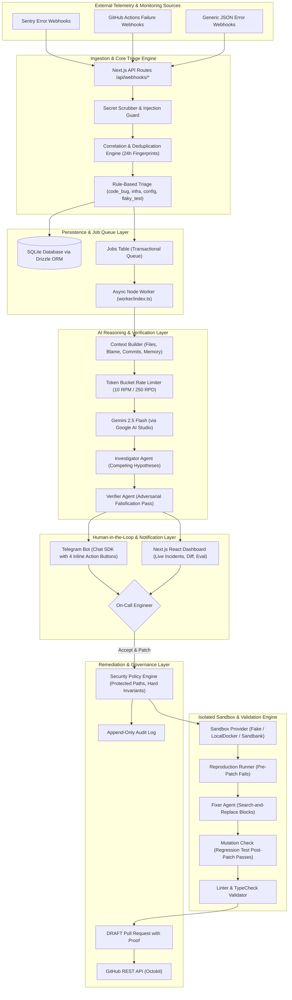

# PatchPilot Technical Architecture & System Design

**Author:** Nebiyu Musbah  
**System:** PatchPilot (AI On-Call DevOps & Remediation Agent)  

---

## 1. High-Level Architecture Diagram

---

## 2. Core Subsystems

### 2.1 Standardized Incident Schema
Every telemetry source is normalized to a common schema:
- `fingerprint`: SHA256 of error type, normalized message, and top in-app stack frame. Volatile UUIDs, numbers, and hex strings are scrubbed to prevent alert duplication.
- `occurrences`: Incremented automatically when the same fingerprint is detected within 24 hours.
- `relatedSignals`: Correlated multi-source signals (e.g. Sentry error + failed GitHub Action run) occurring on the same commit SHA within 30 minutes.

### 2.2 Adversarial Falsification Investigation
Unlike naive agents that accept the first plausible theory, PatchPilot formulates multiple **competing hypotheses** and actively seeks evidence to disprove them. If confidence remains below 60% or tests cannot reproduce the failure, PatchPilot abstains and escalates with full evidence to human engineers.

### 2.3 Isolated Sandbox Validation & Mutation Testing
1. No GitHub credentials enter the sandbox.
2. A regression test is generated and tested against the pre-patch code (must fail).
3. Search-and-replace edits are applied and tested against the regression test (must pass).
4. Code passes linter and typecheck before PR creation.

### 2.4 Governance & Hard Invariants
- `merge_pr` and `deploy_code` are strictly denied in code.
- Repository mutation requires `humanApproved: true`.
- Protected directories (`migrations/`, `infra/`, `.github/`) are blocked.
- Append-only audit logging for every agent action.
